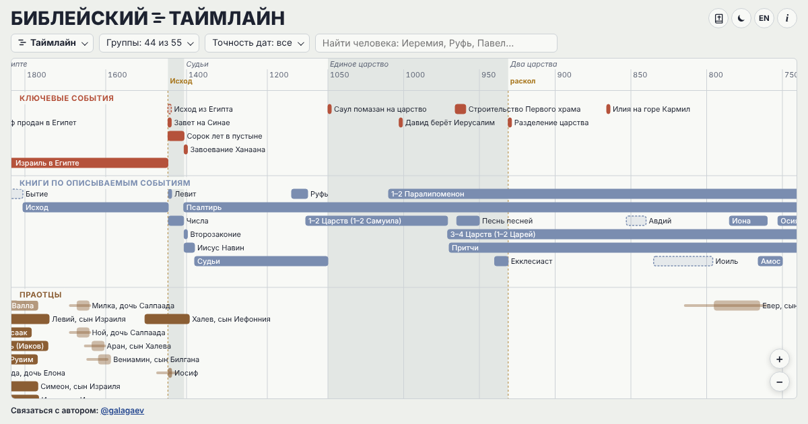

# Библейский таймлайн

**3 548 человек и 778 событий от Адама до наших дней: все, кто назван в Библии, и главные фигуры христианства.**

Интерактивная шкала времени Библии: пророки, цари Израиля и Иудеи, апостолы, судьи, женщины Библии, родословия от Адама до Иисуса, карта путешествий и государств, история церкви и мировые правители — всё в одном масштабе времени.

**Сайт:** https://galagaev.github.io/bible-timeline-rus/  ·  English version: https://galagaev.github.io/bible-timeline/

## Что внутри
- **Таймлайн** — все, кто назван в Библии по имени, и ключевые события; годы служения, правления и жизни.
- **Карта** — места событий, пути апостола Павла и других, границы государств по годам.
- **Родословие** — линии от Адама до Иисуса по Матфею и Луке, цари, первосвященники, двенадцать колен.
- **Парадоксы времени** — неожиданные сравнения эпох.
- **«Тем временем»** — кто ещё жил в выбранные годы.
- **Библия внутри страницы** — Синодальный перевод и KJV.

## Источники
Theographic Bible Metadata (CC BY-SA 4.0), BibleHub, словарь Истона (общественное достояние), Cliopatria / Seshat (CC BY 4.0), Natural Earth.
